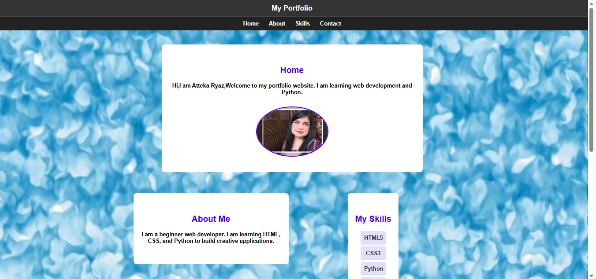
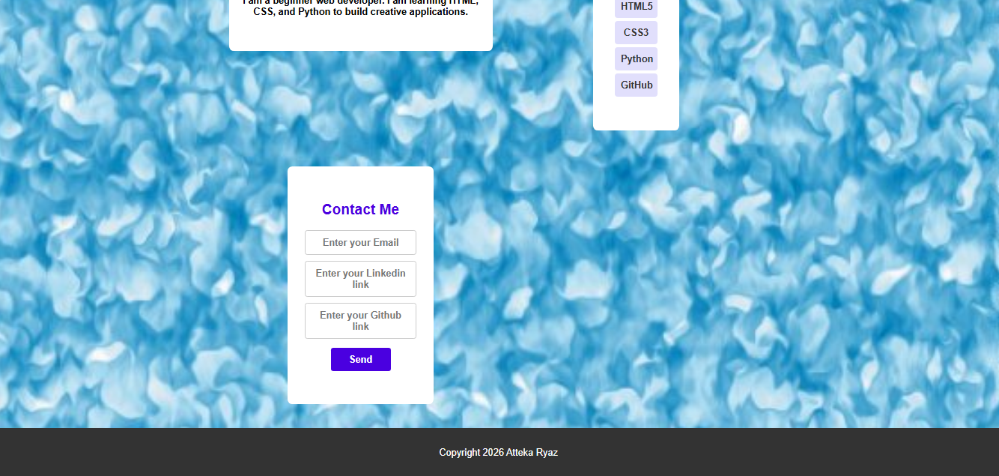

# 🌟 My Portfolio Website - Module 2

Welcome to Module 2 of my professional web development portfolio project! This repository showcases a fully responsive, modern layout built using HTML5 and CSS3.

## 🚀 Project Features & Objectives Completed
* **Responsive Design:** Fluid layout that adapts seamlessly across mobile, tablet, and desktop viewports.
* **Modern CSS Styling:** Utilizes advanced CSS Grid and Flexbox for clean and structural alignment.
* **Aesthetic Enhancements:** Custom typography, structured sectioning, styled buttons, and a clean blue textured fixed background image (`background-attachment: fixed`).
* **Navigation Bar:** Integrated structured top navigation links (`Home`, `About`, `Skills`, `Contact`) for clean user navigation.

## 🛠️ Tech Stack Used
* **HTML5** (Semantic markup, structural layout tags)
* **CSS3** (Styling, Flexbox, Grid, background positioning)

* **Top Section (Home, About & Skills):**  
  

* **Bottom Section (Contact & Footer):**  
  
---
*Developed with dedication as part of web engineering and front-end design practice.*# My_Portfolio_Web_Programming_2nd_Module

